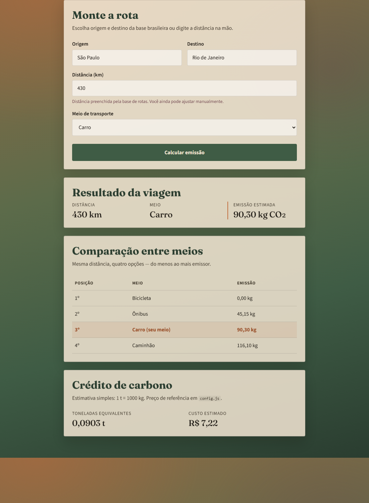

# EcoTrip — Calculadora de CO₂

Lab da DIO em HTML, CSS e JavaScript puro. Sem framework, sem backend de verdade: a “API” de distância mora num arquivo JS pra depois dar pra trocar por mapas se quiser.

Calcula a emissão estimada de uma viagem entre cidades brasileiras, compara bicicleta / carro / ônibus / caminhão e mostra um custo aproximado de crédito de carbono.

## Como usar

1. Abra o [Pages](https://sir-devtech.github.io/calculadora-ecotrip-dio/) ou rode a pasta localmente (qualquer server estático na raiz).
2. Digite origem e destino (tem autocomplete com a base BR).
3. Se a rota existir na base, a distância preenche sozinha — senão, coloca o km na mão.
4. Escolhe o meio e clica em **Calcular emissão**.
5. Resultado, comparação e créditos só aparecem depois do cálculo.

Print de uma viagem SP → RJ de carro:



## Como o cálculo funciona

- Distância: `routesDB.findDistance(origem, destino)` em `js/routes-data.js` (nos dois sentidos). Fora da base → input manual.
- Emissão: `km × fator` (`js/config.js`). Ex.: carro `0.21` kg CO₂/km.
- Comparação: roda o mesmo km nos quatro meios e ordena do menor pro maior.
- Crédito: kg ÷ 1000 = toneladas; × preço por tonelada (padrão R$ 80 em `config.js`).

Números são estimativa didática, não laudo ambiental.

## Estrutura

```
index.html
css/style.css
js/routes-data.js   → base de rotas + findDistance
js/config.js        → fatores e preço do crédito
js/calculator.js    → emissão, comparação, custo
js/ui.js            → DOM, autocomplete, painéis
js/app.js           → eventos e boot
.github/workflows/pages.yml
docs/prints/viagem-sp-rio.png
```

Deploy: push na `main` dispara GitHub Actions → GitHub Pages (source = Actions).

## Prompt que funcionou

> Monta a Calculadora EcoTrip em HTML/CSS/JS puro: origem/destino com autocomplete numa base BR, distância manual se não achar rota, quatro meios (bike/carro/ônibus/caminhão), resultado + comparação + crédito de carbono. Isola `findDistance` pra trocar por API depois. Visual de estrada ao entardecer (não o verde genérico), BEM + variáveis CSS, Fraunces + Source Sans 3. Workflow Pages via Actions. README no meu tom e commit só no meu nome, sem Co-authored-by.

## Links

- Repositório (entrega): https://github.com/sir-devtech/calculadora-ecotrip-dio
- Demo Pages: https://sir-devtech.github.io/calculadora-ecotrip-dio/
